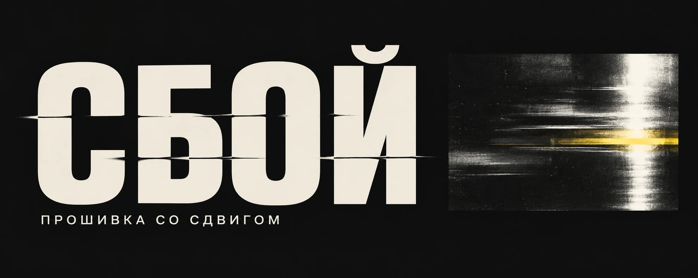
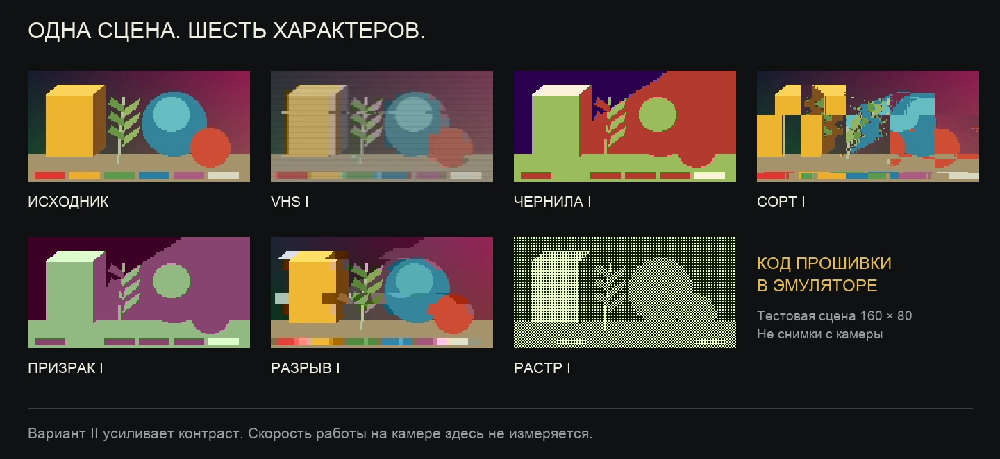

# СБОЙ

**Художественные эффекты и своя прошивка для маленькой камеры.**



[](https://github.com/azbezd/charmera-sboy/actions/workflows/checks.yml)
[](https://github.com/azbezd/charmera-sboy/releases/tag/v0.9.0-experimental)
[](LICENSE)

[Скачать комплект](https://github.com/azbezd/charmera-sboy/releases/tag/v0.9.0-experimental) · [Совместимость](docs/compatibility.md) · [Первый запуск](docs/getting-started.md) · [Установка](docs/install.md)

Проект начался с камеры, купленной как Charmera, и замены разбитого дисплея. Через USB удалось прочитать её прошивку, запустить новый ST7735, а затем добавить глитч-эффекты, русские заставки и меню поверх живой картинки. Здесь — инструменты, исходники модификаций и воспроизводимые патчи.

**Пока поддерживается один вариант: плата Ax3295B-V3.0 с заменённым ST7735 и точным заводским хешем. Красная камера и штатный дисплей этими патчами не поддерживаются.** Цвет корпуса и USB-ID сами по себе совместимость не доказывают. Проект независимый, не связан с Kodak/RETO.

## Шесть способов испортить картинку красиво



*Это синтетическая сцена, обработанная реальными инструкциями прошивки в эмуляторе, а не фотографии с камеры. [Как сделана демонстрация](docs/visuals.md).*

Режимы идут попарно: **VHS I/II → ЧЕРНИЛА I/II → СОРТ I/II → ПРИЗРАК I/II → РАЗРЫВ I/II → РАСТР I/II**. Вариант II усиливает контраст: всего шесть алгоритмов и двенадцать настроек.

Кроме эффектов:

- **Живое меню:** переключение стрелками, скрытие через две секунды и при снимке. Подпись режима не попадает в сохранённое фото.
- **Фото и видео:** обработка кадров, дата без часов, сохранённый штатный звуковой тракт. Эффекты могут снижать FPS; ускорение камеры не заявлено.
- **Свой интерфейс:** русские экраны включения, выключения и USB, новые значки. Удержание ↓ включает постоянный белый свет; значок показывает его состояние.

[Аппаратные проверки и ограничения](docs/validation.md) · [Как работает подсветка](docs/flash.md)

## Начать с чтения

Нужны macOS, Python 3.9+, libusb, USB-кабель и microSD. Первое действие — узнать, что подключено, без захвата устройства:

```sh
git clone https://github.com/azbezd/charmera-sboy.git
cd charmera-sboy
python3 tools/identify.py --usb
```

Если libusb ещё не установлен, его можно установить через Homebrew: `brew install libusb`. Для дампа ридер проверит дескрипторы и отпечатки кода, прочитает 1 MiB дважды и сравнит результаты. Неизвестный профиль отклоняется.

**[Пройти путь: идентификация → два резервных чтения → проверка хеша → сборка](docs/getting-started.md)**

Сам образ создаётся локально из вашего совместимого заводского дампа. Полных заводских прошивок в комплекте нет. Чтение идёт по USB; запись выполняет штатный обновлятор с microSD. Публичный ридер не содержит команд стирания или записи флеш.

## Перед установкой

| Камера | USB с microSD | Этот выпуск |
|---|---|---|
| A — исследованная жёлтая, заменённый ST7735 | `0219:3280` | Патчи только для точного заводского SHA-256 |
| B — исследованная красная | `05e3:f12b` | Другие адреса кода; перенос образа A запрещён |
| Другой экземпляр или родной экран | Любой | Совместимость не установлена |

**Не переставляйте между камерами карту с `DestBin.bin`.** Этот файл может запускать обновление при включении. Проверки нашего сборщика на Mac не являются защитой обновлятора внутри другой камеры. После успешной установки и проверки удалите файл обновления с карты.

[Полные хеши и аппаратные варианты](docs/compatibility.md) · [Установка, проверка и возврат версии](docs/install.md)

## Разобраться глубже

| Документ | Что внутри |
|---|---|
| [USB-протокол](docs/protocol.md) | Команды чтения, проверки кода и особенности macOS |
| [Архитектура](docs/architecture.md) | OR1K, YUV-эффекты, видеотракт и меню |
| [Проверки](docs/validation.md) | Что проверено на камере, что — в эмуляторе |
| [Участие в проекте](CONTRIBUTING.md) | Тесты, новые аппаратные варианты, сообщения об ошибках |
| [Изменения](CHANGELOG.md) | История выпусков |
| [Источники](docs/sources.md) | Предшествующие исследования и документация |

Собственный код, документация и графика — [MIT](LICENSE). Закрытая заводская прошивка и товарные знаки под эту лицензию не попадают.
